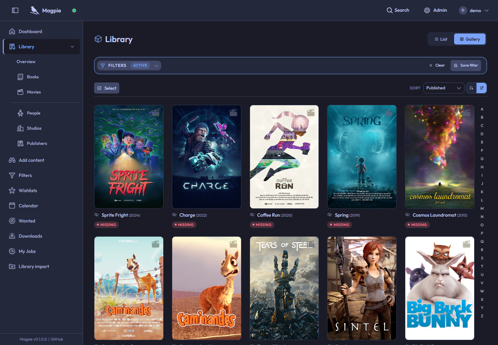
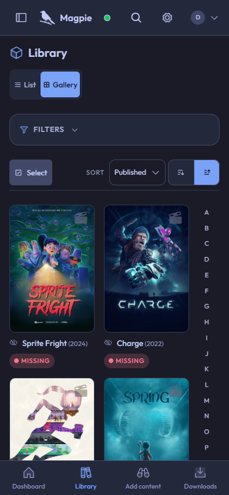

# Showcase

[Documentation](README.md)

A look at Magpie.

- [Library and content](showcase/library.md)
- [Filters](showcase/filters.md)
- [Themes](showcase/themes.md)
- [Wishlists](showcase/wishlists.md)
- [Acquiring content](showcase/acquiring-content.md)
- [Installing an extension](showcase/extensions.md)

## Desktop

## Mobile

